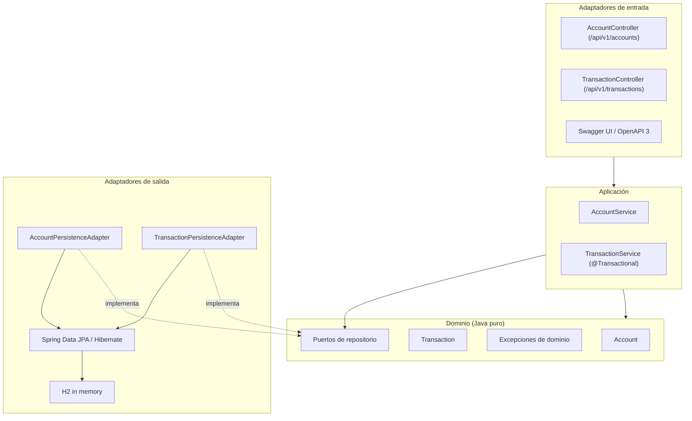

# API REST de banca central en Java 21 y Spring Boot 3

[](https://openjdk.org/)
[](https://spring.io/projects/spring-boot)
[](https://en.wikipedia.org/wiki/Hexagonal_architecture_(software))
[](https://www.h2database.com/)
[-success.svg)](src/test/)

Autor: Gustavo Bryan López Cosme (FIIS UNI | LabIAR)

Microservicio transaccional en Java 21 LTS y Spring Boot 3.3 para apertura de cuentas, abonos, retiros y transferencias atómicas entre cuentas usando arquitectura hexagonal (puertos y adaptadores) sobre base en memoria H2.

## Qué cubre el diseño

* **Aislamiento del dominio:** Las entidades (`Account`, `Transaction`), excepciones de negocio y puertos de salida están escritos en Java puro sin anotaciones de Spring ni JPA.
* **Transferencias atómicas (ACID):** Débito y crédito corren dentro de `@Transactional` con rollback si falla alguna validación o si las monedas no coinciden.
* **Errores RFC 7807:** Los fallos de dominio devuelven `ProblemDetail` con código HTTP según el caso (`400`, `404` o `422`).
* **OpenAPI 3:** Documentación de endpoints en Swagger UI.

## Arquitectura hexagonal



## Endpoints disponibles

| Método | Ruta | Operación | Respuestas |
|---|---|---|---|
| `POST` | `/api/v1/accounts` | Abre una cuenta con saldo inicial | `201 Created`, `400 Bad Request` |
| `GET` | `/api/v1/accounts/{accountNumber}` | Consulta una cuenta por número | `200 OK`, `404 Not Found` |
| `GET` | `/api/v1/accounts` | Lista las cuentas registradas | `200 OK` |
| `POST` | `/api/v1/transactions/deposit` | Registra un depósito en cuenta activa | `201 Created`, `400 Bad Request` |
| `POST` | `/api/v1/transactions/withdraw` | Retira fondos validando saldo | `201 Created`, `422 Unprocessable` |
| `POST` | `/api/v1/transactions/transfer` | Transfiere entre cuentas de la misma moneda | `201 Created`, `400`, `404`, `422` |
| `GET` | `/api/v1/transactions/history/{acc}` | Devuelve historial de movimientos | `200 OK`, `404 Not Found` |

## Pruebas automatizadas (12 tests)

Las pruebas cubren tres niveles:

1. `AccountDomainTest`: saldo inicial negativo, depósito, retiro, fondos insuficientes y cuenta inactiva.
2. `TransactionServiceTest` (Mockito): aislamiento de puertos, transferencia exitosa y rechazo cuando difiere la moneda (PEN vs USD).
3. `AccountControllerIntegrationTest` (MockMvc): contratos JSON, códigos HTTP y respuestas RFC 7807.

```text
[INFO] Tests run: 12, Failures: 0, Errors: 0, Skipped: 0
[INFO] BUILD SUCCESS
```

## Cómo ejecutarlo

Requiere Java 21 LTS. Puedes usar Maven instalado en el sistema o el wrapper (`./mvnw` / `mvnw.cmd`) incluido en el repo:

```bash
git clone https://github.com/Gus7Ghost/java-core-banking-api.git
cd java-core-banking-api

# Correr las 12 pruebas
./mvnw test

# Levantar el servicio
./mvnw spring-boot:run
```

Una vez arriba, las rutas locales quedan en:

* Swagger UI: `http://localhost:8080/swagger-ui.html`
* Consola H2: `http://localhost:8080/h2-console` (`jdbc:h2:mem:bankingdb`, usuario `sa`, sin contraseña)
