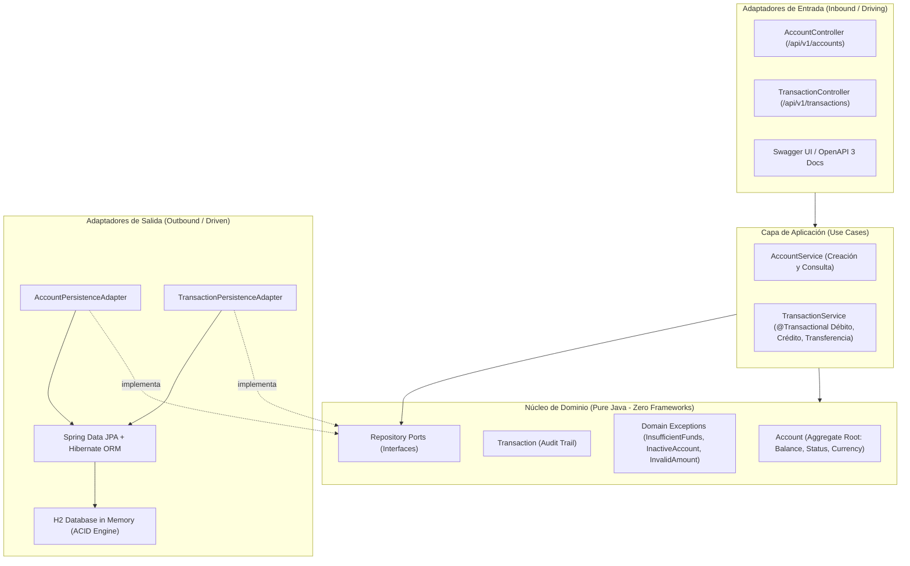

# Core Banking & Transactional Microservice API

[](https://openjdk.org/)
[](https://spring.io/projects/spring-boot)
[](https://en.wikipedia.org/wiki/Hexagonal_architecture_(software))
[](https://www.h2database.com/)
[-success.svg)](src/test/)

**Autor:** Gustavo Bryan López Cosme  
**Institución:** Universidad Nacional de Ingeniería (FIIS UNI) | LabIAR  
**Especialización:** Ingeniería de Software Backend & Arquitectura Empresarial

---

## 📌 1. Problema de Negocio y Objetivos

Los sistemas transaccionales financieros (Core Banking) requieren el más alto estándar de **integridad transaccional (ACID)**, desacoplamiento del dominio respecto a frameworks externos y manejo estricto de concurrencia y validaciones de negocio.

### Objetivos del Microservicio:
1. **Aislar la lógica de dominio bancario** mediante **Arquitectura Hexagonal (Puertos y Adaptadores)**, asegurando que las reglas de negocio no dependan de Spring Boot, Hibernate ni de la base de datos.
2. **Garantizar atomicidad en transferencias bancarias:** Ejecutar débitos y créditos en la misma frontera transaccional con reversión automática (*rollback*) ante fallos.
3. **Manejo estandarizado de errores:** Respuestas REST conformes a la especificación **RFC 7807 (Problem Details)** con códigos HTTP semánticos (201, 400, 404, 422).
4. **Documentación interactiva:** Especificación OpenAPI 3 integrada con **Swagger UI**.

---

## 🏛️ 2. Arquitectura Hexagonal (Puertos y Adaptadores)



---

## 📋 3. Catálogo de Endpoints REST

| Método | Endpoint | Descripción | Códigos HTTP |
|---|---|---|---|
| `POST` | `/api/v1/accounts` | Apertura de nueva cuenta bancaria con saldo inicial | `201 Created`, `400 Bad Request` |
| `GET` | `/api/v1/accounts/{accountNumber}` | Consulta de saldo y datos de titularidad | `200 OK`, `404 Not Found` |
| `GET` | `/api/v1/accounts` | Listado general de cuentas registradas | `200 OK` |
| `POST` | `/api/v1/transactions/deposit` | Abono de fondos a cuenta activa | `201 Created`, `400 Bad Request` |
| `POST` | `/api/v1/transactions/withdraw` | Retiro de fondos con validación de saldo | `201 Created`, `422 Unprocessable` |
| `POST` | `/api/v1/transactions/transfer` | Transferencia atómica entre cuentas (misma moneda) | `201 Created`, `400`, `404`, `422` |
| `GET` | `/api/v1/transactions/history/{acc}` | Auditoría cronológica de movimientos | `200 OK`, `404 Not Found` |

---

## 🧪 4. Suite de Pruebas Automatizadas (12 Tests)

El proyecto cuenta con una cobertura integral de pruebas estructurada en 3 niveles:

1. **Dominio Puro (`AccountDomainTest`):**
   * Creación válida y rechazo de saldo inicial negativo.
   * Reglas de negocio: depósito, retiro, fondos insuficientes y bloqueo por cuenta inactiva.
2. **Servicios de Aplicación (`TransactionServiceTest` con Mockito):**
   * Aislamiento de llamadas a puertos de persistencia.
   * Transferencia atómica exitosa verificando saldos simultáneos.
   * Validación de incompatibilidad cambiaria (rechazo de transferencias PEN vs USD).
3. **Integración Web (`AccountControllerIntegrationTest` con MockMvc):**
   * Validación de contratos JSON, códigos HTTP y serialización RFC 7807 de `ProblemDetail`.

```text
[INFO] Tests run: 12, Failures: 0, Errors: 0, Skipped: 0
[INFO] BUILD SUCCESS
```

---

## 🚀 5. Ejecución y Despliegue Local

### Requisitos:
* Java 21 LTS instalado.
* Maven 3.9+ instalado (o ejecutable desde consola).

### Comandos de ejecución:
```bash
# 1. Clonar el repositorio
git clone https://github.com/Gus7Ghost/java-core-banking-api.git
cd java-core-banking-api

# 2. Ejecutar la suite de pruebas unitarias e integración
mvn test

# 3. Iniciar la aplicación
mvn spring-boot:run
```

* **Swagger UI interactivo:** `http://localhost:8080/swagger-ui.html`
* **Consola de Base de Datos H2:** `http://localhost:8080/h2-console` *(JDBC URL: `jdbc:h2:mem:bankingdb`, Usuario: `sa`, Contraseña en blanco)*.
